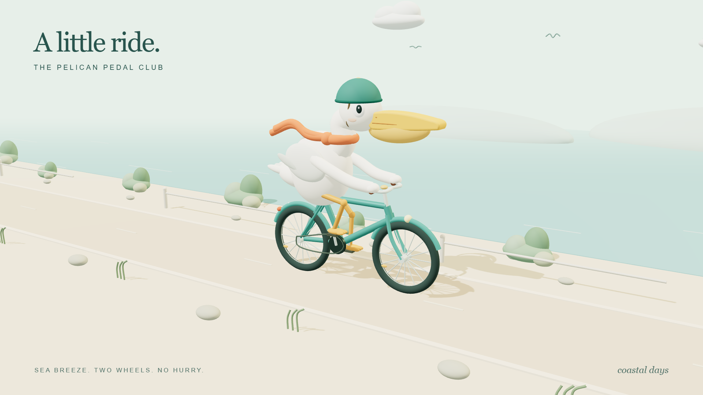

# 鹈鹕的海边骑行 · Pelican Pedal Club

使用 **Remotion + Three.js + React Three Fiber** 制作的黏土玩具风格 3D 动画：一只戴头盔、系围巾的鹈鹕，骑着薄荷绿自行车沿海岸小路前进。



## 在线观看

打开 [鹈鹕骑自行车动画](https://zyk262.github.io/pelican-riding-a-bicycle/)，即可自动循环播放 3D 动画。支持暂停、拖动进度和全屏观看。

网页使用 `@remotion/player` 播放同一份动画源码，无需先导出 MP4。

### GitHub Pages 部署

在仓库 **Settings → Pages → Build and deployment → Source** 中选择 **GitHub Actions**。
推送到 `main` 后，`.github/workflows/pages.yml` 自动安装依赖、检查代码、构建并部署网页。
可在 **Actions → Deploy animation to GitHub Pages** 查看状态或手动运行。

本地网页预览：

```sh
npm run dev:site
```

按终端显示的地址访问 `/pelican-riding-a-bicycle/`。
`npm run build:site` 将网页构建到 `dist/`，`npm run preview:site` 可预览构建结果。

## 动画内容

- 1920 × 1080，30 fps，12 秒，无声动画。
- 程序化 3D 鹈鹕，包括长喙、喉囊、翅膀、脚蹼和骑行头盔。
- 脚蹼跟随踏板运动，双腿使用两段逆运动学计算姿势。
- 自行车包含车架、轮胎、辐条、链条、车铃和挡泥板；车轮与路面移动速度同步。
- 围巾随风摆动，鹈鹕眨眼、轻微起伏，镜头缓慢摆动。
- 海岸、海面、云朵、灌木、飞鸟，以及柔和灯光和实时阴影。
- 全部动画由 Remotion 帧号驱动，支持暂停、拖动时间轴和逐帧渲染。
- 模型全部由代码生成，无需下载外部模型或图片。

## 安装与预览

需要 Node.js 22 或更高版本、npm 和 Git。

```sh
git clone https://github.com/zyk262/pelican-riding-a-bicycle.git
cd pelican-riding-a-bicycle
npm ci
npm run dev
```

终端会显示 Studio 地址。默认访问 [动画预览](http://localhost:3000/PelicanRide)，点击播放即可观看。若 3000 端口已被占用，以终端显示的地址为准。

在右侧 Default Props 面板中可修改车架颜色、围巾颜色及标题显示；点击保存可写回源码。

## 检查、构建与导出

```sh
npm run lint
npm run build
npm run render
```

`lint` 执行 ESLint 和 TypeScript 检查，`build` 生成 Remotion 构建文件，`render` 导出 H.264 MP4 到 `out/pelican-ride.mp4`。

导出使用支持 WebGL 的 Chromium，首次导出时 Remotion 会自动下载所需浏览器。

导出单帧：

```sh
npx remotion still src/index.ts PelicanRide out/pelican-preview.png --frame=70 --gl=angle
```

## 项目文件

| 文件 | 用途 |
| --- | --- |
| `src/Root.tsx` | 合成注册、时长、分辨率、默认配色 |
| `src/Composition.tsx` | 镜头、灯光、场景组合、标题 |
| `src/Pelican.tsx` | 鹈鹕、自行车模型及踩踏动作 |
| `src/Scenery.tsx` | 海岸环境、景物及路面移动 |
| `remotion.config.ts` | Remotion 构建和渲染配置 |
| `docs/pelican-preview.png` | 已渲染的动画预览图 |

依赖版本通过 `package-lock.json` 固定。依赖目录、构建文件和视频输出不纳入版本控制。
